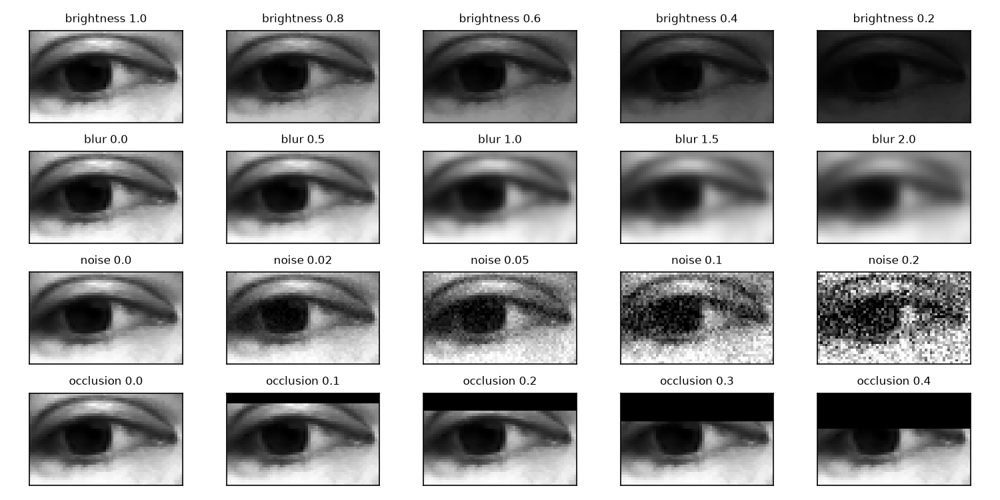
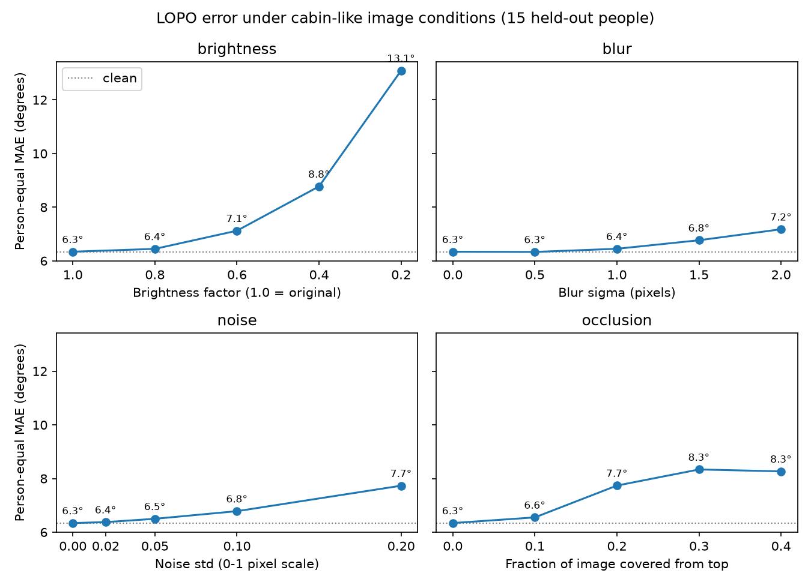

# GazeMap

GazeMap is a small CNN that predicts gaze direction (pitch and yaw) from a normalized 36×60 eye image, trained and evaluated on MPIIGaze. The point of the project is the evaluation: how well the model works on people it has never seen, and where it fails. Error is mean angular error in degrees.

## Key findings

- **Unseen people: 6.35°** person-equal error with leave-one-person-out over 15 subjects (standard error about 0.24°). This is within the published MPIIGaze LOPO range of 5.5° to 8.7°, and close to the 6.5° I predicted before running it. A rerun reproduced it within 0.01°.
- **A random frame split overstates accuracy.** The same model scores 4.01° when near-identical frames from one recording end up in both training and test.
- **Head pose:** error stays near 6.2° up to 20° of head rotation and rises to about 7.8° beyond 30°. The trend holds within 12 of 14 people.
- **Image conditions:** blur and sensor noise cost little (+0.8° and +1.4° at the strongest level). Low light is the weak point: at 20% brightness error doubles to 13.1°, for all 15 people. Covering the top 20-30% of the eye image adds 1.4-2.0°.

## Results

### Within-person baseline

Mean angular error: **4.01°**

| | |
|---|---|
| Data | MPIIGaze, subject p00, day01 only |
| Split | 80/20 random split, seed 42 |
| Model | Two convolution layers (1→8→16, kernel size 5), fully connected 1152→16→2 |
| Training | Adam, learning rate 1e-3, batch size 16, MSELoss, 5 epochs |
| Hardware | Apple M1 CPU |

This split is optimistic. Frames come from continuous recordings, so neighboring frames can have nearly identical eye appearance and gaze direction. Similar frames can therefore appear in both training and validation.

The 4.01° value is a useful baseline, but it is not a person-independent performance claim.

### Person-independent LOPO evaluation

The final evaluation used leave-one-person-out cross-validation over all 15 subjects, p00–p14. For each fold, one complete subject was held out for testing, a fresh model and optimizer were created, and the model trained on the other 14 subjects.

| | |
|---|---|
| Data | MPIIGaze, all 15 subjects |
| Split | One complete subject held out per fold |
| Model | Same small two-convolution CNN |
| Input | Normalized right-eye images, shape 1×36×60 |
| Training | Adam, learning rate 1e-3, batch size 128, MSELoss, fixed 5-epoch budget |
| Seed | 42 reset at the start of every fold |
| Hardware | Apple Silicon MPS GPU |
| Total test samples | 213,658 |

The primary person-equal mean MAE was **6.35°** with a population standard deviation of **0.93°** and a standard error of approximately **0.24°**.

The pooled per-sample MAE was **6.09°**. The difference between 6.35° and 6.09° reflects the strong imbalance in test-set sizes: p03 has 35,075 test samples while p13 has 1,498, a roughly 23× difference. Person-equal MAE is therefore the primary number for a person-independent claim; the pooled value gives the sample-weighted view.

## What the result means

The model generalizes to unseen people, but the error is higher than the 4.01° within-person baseline. This gap shows why a random frame split is not enough for this task.

The fold extremes are meaningful under the fixed per-fold seed: p00 remains the easiest subject, while p04 and p14 remain among the hardest. However, the complete subject ranking should not be treated as stable. Error can vary more between epochs within one subject than between subjects: p07 spans approximately 2.04° across the five epochs, while the between-subject population standard deviation is 0.93°.

Five epochs were a fixed compute budget, not a convergence claim. Several folds were still improving when the budget ended, so the reported epoch-5 values were not selected by looking for the best epoch on the held-out subject. Selecting the best test epoch would use the test set for model selection and introduce optimistic bias.

MPS results can vary slightly between reruns and hardware because numerical execution is not fully deterministic. The reported 6.35° is the observed result for this fixed configuration, not a universal exact constant.

A rerun on 2026-10-06 with the identical configuration gave a person-equal MAE of 6.34° (pooled 6.05°), within 0.01° of the reported value. Individual folds moved by up to 0.48° (p00: 4.12° to 3.64°), so the aggregate is reproducible but the per-subject ranking is not. The pose and robustness analyses below use this rerun's per-sample errors and saved fold models. The original per-fold results are kept in `lopo_results_2026-09-17.csv`.

## Prediction check

Before running LOPO, I predicted a mean error of approximately **6.50°**, based on the published MPIIGaze LOPO baselines and the limited capacity of this small CNN. The observed mean was **6.35°**, a difference of **0.15°**, or approximately **0.63 standard errors**. The prediction was therefore within the noise of the final estimate.

This result is in the range of published person-independent MPIIGaze baselines. It should not be described as matching MnistNet or any other published model because the architectures, preprocessing, training budget, and input setup are not controlled comparisons.

## Published comparison

Zhang et al., *MPIIGaze: Real-World Dataset and Deep Appearance-Based Gaze Estimation* (TPAMI, arXiv:1711.09017), report leave-one-person-out MPIIGaze errors ranging from approximately **5.5° for GazeNet**, their best method, to **8.7° for simpler baselines**. Their **MnistNet** result is approximately **6.3°**. GazeMap’s 6.35° is within this published LOPO baseline range, but the result is not a direct architecture-to-architecture comparison.

## Head-pose analysis

Does the error depend on how far the head is turned away from the camera? For every LOPO test sample, the head pose (a rotation vector in the normalized data) was converted into one number: the angle between the direction the face points and the camera axis. Samples were grouped into 10° bins. The last bin is 40° and above, because past about 45° only a few people have data.

| Head rotation | Samples | People | Person-equal MAE | Pooled MAE | Mean gaze angle |
|---|---|---|---|---|---|
| 0-10° | 51,921 | 14 | 6.17° | 5.48° | 11.6° |
| 10-20° | 78,351 | 15 | 6.25° | 5.81° | 12.5° |
| 20-30° | 57,834 | 15 | 6.56° | 6.16° | 12.8° |
| 30-40° | 21,287 | 14 | 7.78° | 7.74° | 13.2° |
| 40°+ | 4,265 | 12 | 7.74° | 7.61° | 12.6° |

"People" counts subjects with at least 50 samples in the bin. Person-equal MAE is the primary number, for the same reason as in the LOPO result.

Error stays close to 6.2° up to 20° of head rotation, rises slightly at 20-30°, and then steps up by about 1.2° beyond 30°.

Two other explanations were checked:

- **Gaze direction.** If turned-head samples also had more extreme gaze, gaze could explain the rise. The mean gaze angle changes by only about 1.6° across bins (11.6° to 13.2°), so this is unlikely to account for it.
- **Subject mix.** Harder subjects might simply sit more turned. Within each person, error on turned samples (25° and above) was compared with error on frontal samples (below 10°). Error was higher when turned for 12 of 14 people. The exceptions were p07 and p12; p11 had too few frontal samples to compare.

Only about 12% of all samples have the head turned 30° or more, so the model sees few such examples during training. That, and the more side-on view of the eye, are plausible reasons for the step, but this analysis does not separate them. It is an observational result within MPIIGaze, not a controlled experiment: it shows where the model is weaker, not exactly why.

Reproduce with `python analyze_pose.py`. It reads `lopo_sample_results.csv` (written by `lopo_train_all_folds.py`, about 30 MB, not committed) and writes `pose_results.csv` and `pose_error.png`.

## Cabin-condition robustness

How does error change when the eye image degrades in ways an in-car camera might see? Each saved LOPO fold model was evaluated on its own held-out person after a synthetic corruption, at five severity levels. Nothing was retrained. Level 0 is the clean image; for every fold it reproduced the LOPO result within 0.05°, which confirms that each model was paired with the right person's data.

| Condition | What it simulates | Severity levels 0 to 4 |
|---|---|---|
| Brightness | weaker illumination | pixel values × 1.0, 0.8, 0.6, 0.4, 0.2 |
| Blur | motion or defocus | Gaussian σ = 0, 0.5, 1, 1.5, 2 px |
| Noise | low-light sensor noise | Gaussian std = 0, 0.02, 0.05, 0.1, 0.2 (pixels scaled 0-1) |
| Occlusion | eyelid, glasses frame, hair | top 0, 10, 20, 30, 40% of rows set to black |

Person-equal MAE:

| Condition | Level 0 | Level 1 | Level 2 | Level 3 | Level 4 | People worse at level 4 |
|---|---|---|---|---|---|---|
| Brightness | 6.34° | 6.45° | 7.12° | 8.77° | 13.09° | 15 of 15 |
| Occlusion | 6.34° | 6.55° | 7.74° | 8.34° | 8.27° | 15 of 15 |
| Noise | 6.34° | 6.37° | 6.50° | 6.78° | 7.73° | 13 of 15 |
| Blur | 6.34° | 6.33° | 6.45° | 6.77° | 7.18° | 13 of 15 |

Level 0 is 6.34° rather than 6.35° because these are the rerun's models.

- **Low light is the main weakness.** Mild dimming costs little, but at ×0.4 error reaches 8.77° and at ×0.2 it doubles to 13.09°, for every person. The easiest subject, p00, goes from 3.64° to 17.04°.
- **Occlusion** adds about 1.4° once 20% of the image is covered, for every person, and then levels off.
- **Noise and blur** degrade slowly. At the strongest noise level the image looks heavily corrupted, yet error rises by only 1.4°.

The model tolerates losing fine detail far better than a global change in intensity. A plausible reason is that it was trained only on the dataset's brightness range and its input is not normalized per image, so a dark image falls outside what it learned. Per-image intensity normalization or brightness augmentation would be the first thing to try. Both need retraining, which was outside this project's scope.

Reproduce with `python robustness.py`. It needs the fold models in `models/`, written by `lopo_train_all_folds.py`, and writes `robustness_results.csv`, `robustness_summary.csv` and both images.

## Scope

GazeMap estimates gaze direction from an eye image. It does not estimate screen point-of-gaze, perform user calibration, or provide a real-time application.

Frame-stride subsampling was considered as a speed optimization but was not needed: the full-data evaluation completed in under half an hour after the cumulative-index lookup was improved. The reported LOPO result therefore uses all available frames.

## Limitations

- One dataset: MPIIGaze, 15 people, laptop webcam, everyday indoor light. Results may not transfer to infrared in-car cameras.
- Right-eye images only, no face or head-pose input, and a deliberately small CNN trained for a fixed 5 epochs.
- The corruptions are synthetic. Real low light, motion blur and occlusion look different from these approximations.
- The head-pose and robustness results are observational. They show where the model is weaker, not exactly why.
- MPS execution is not fully deterministic. Single folds can move by about 0.5° between reruns; the 15-person mean moved by 0.01°.

## Reproduce

1. Download MPIIGaze and place it so that `dataset/Data/Normalized/p00` to `p14` exist.
2. `python3 -m venv .gazemap-env`, activate it, then `pip install -r requirements.txt`.
3. `python lopo_train_all_folds.py` trains the 15 fold models (about 30 minutes on an Apple M1 GPU) and writes `lopo_results.csv`, `lopo_sample_results.csv` and `models/`.
4. `python analyze_pose.py` runs the head-pose analysis.
5. `python robustness.py` runs the image-condition analysis.
