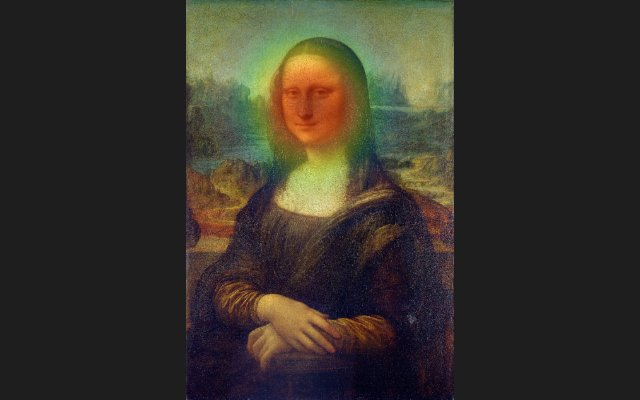
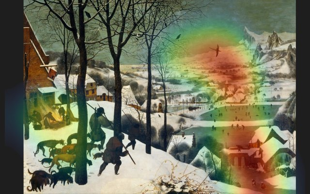
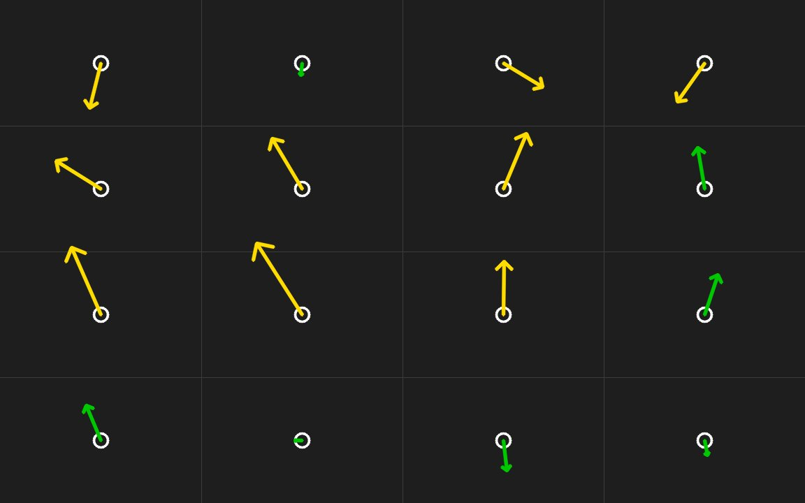

# GazeMap

**Webcam gaze tracking and attention heatmaps, running offline on a laptop.** A small CNN trained on MPIIGaze estimates where each eye is looking. After a one-minute calibration, GazeMap maps that to the screen and records where you looked on an image or a video. Nothing leaves your computer.


*Watching street footage. Left: gaze trail over the last second, and the yellow disc shows the model's ±2° uncertainty. Right: the only input, a laptop webcam, with the predicted gaze of each eye. One user, MacBook Pro 16", 13-dot calibration.*

## What it does

- **Live gaze:** arrows for each eye and both eyes combined, drawn on the webcam image.
- **Image heatmaps:** show a picture or a folder of pictures fullscreen and get a heatmap of where you looked, plus the raw gaze points.
- **Attention video:** watch a video clip and get it back with your gaze trail, the webcam view beside it, a heatmap of the whole clip and a CSV of every sample.
- **Accuracy test:** a 16-dot test that shows the error at each point on the screen.

The model was evaluated on 15 people it never saw during training (leave-one-person-out). The [results](#results) section says what each design choice bought and where the model fails.

## Four steps

| 1. Webcam | 2. Calibrate | 3. Check | 4. Heatmap |
|---|---|---|---|
|  |  |  |  |
| The only sensor. Face points give the head pose, each eye goes to the network. | Look at 13 dots, one at a time. | Look at 16 new dots. Each arrow goes from a dot to where the model put your gaze. | Show any image or video and see where you looked. |

## Examples

| | | |
|---|---|---|
|  |  |  |
| **Mona Lisa.** The face takes almost all of the attention. | **Girl with a Pearl Earring.** The eyes go to her face, not the earring. | **Netherlandish Proverbs.** A crowded scene: many short looks spread over the small stories. |
|  |  |  |
| **Hunters in the Snow.** The eyes travel past the hunters into the valley. | **Reading.** Attention sits on the title and the first lines. | **Visual search.** The eyes sweep the grid looking for the one closed circle. |

**Driving footage.** The same tool on a forward road view, in the style of a hazard perception test. This is not a driver monitoring system: those use an infrared camera inside the car. It asks the same question, though: where were the eyes when something happened?


**Accuracy on the screen.** The 16-dot test from step 3, larger. Mean error 1.6° (1.9 cm on the screen), precision 0.5°. Green arrows are under 1.5°, yellow under 3°.



All examples: one user, MacBook Pro 16", the paintings from `get_stimuli.py`, 8 seconds per image.

## Quick start

```bash
git clone https://github.com/fammad/GazeMap.git
cd GazeMap
python3 -m venv .gazemap-env && source .gazemap-env/bin/activate
pip install -r requirements.txt

python gaze_demo.py --calibrate      # 13 dots, then live gaze arrows
python gaze_demo.py --test           # check accuracy; A adds the test dots to the calibration
python gaze_demo.py --heatmap --stimulus my_image.png
python gaze_demo.py --video my_clip.mp4
```

On the first run, the trained models (about 100 MB) and the MediaPipe face model download automatically. After that everything runs offline. The training data is not needed for the demo.

For good results:
- Sit about 70 cm from the screen, with light on your face.
- Calibrate in the position you will use, and calibrate again if you move. The demo warns you when your head has moved more than 5 cm or turned more than 12°.
- `python get_stimuli.py` downloads a set of public-domain paintings and two test pages for the heatmap slideshow.

| Option | What it does |
|---|---|
| `--screen-width-mm` | physical screen width (default 345, MacBook Pro 16") |
| `--video FILE` | attention video mode; `--show-gaze` shows your gaze while watching, `--no-inset` leaves the webcam out |
| `--stimulus FILE_OR_FOLDER --seconds N` | heatmap slideshow, N seconds per image |
| `--selftest` | runs the pipeline on MPIIGaze frames, no camera (needs the dataset) |

All recordings go to `heatmaps/`.

## How it works

1. MediaPipe finds 6 face points: 4 eye corners and 2 mouth corners.
2. A 3D face model fitted to those points gives the head rotation and position. The estimate is tracked over frames, so a noisy frame cannot flip the head.
3. Each eye is cut out as if seen by a virtual camera 600 mm away looking straight at it: 60×36 pixels, grey, histogram-equalized. This is how MPIIGaze's training images were made. On the dataset's own frames, the result matches the dataset images with a pixel correlation of 0.998.
4. The 15 fold models predict pitch and yaw for each eye, and the predictions are averaged.
5. Calibration fits a per-eye offset, then an affine or quadratic mapping on the screen, whichever has the lower leave-one-out error.

## Results

Error is mean angular error in degrees. Unless stated otherwise, every number is person-equal (each of the 15 held-out people counts once) under leave-one-person-out cross-validation.

### Key findings

- **Unseen people: 6.03° per eye** (SE 0.23°). The original small model scored 6.34°. A network at the paper's size is the only change that clearly helped.
- **Both eyes together: 4.97°.** Averaging the two eyes' predictions in camera space lowers error for all 15 people, often a lot, because the two eyes make different mistakes.
- **9-frame calibration: 3.98°**, tested on recording days other than the calibration day. It still helps when the head turns, but the gain shrinks from 0.9° to 0.5° beyond 20° of head movement.
- **Weak spots:** error rises from about 5.8° to 7.3° when the head is turned more than 30°, and covering the top 30% of the eye image adds 2.4°. Darkness costs nothing once the image is histogram-equalized, as the pipeline does.
- **Gaze range:** MPIIGaze only contains people looking at a laptop screen, from 20° below the camera to about 5° above it. The model cannot recognise gaze outside that range, such as looking up at the ceiling.

### Setup

| | |
|---|---|
| Data | MPIIGaze normalized eye images, 15 people, 213,658 frames, both eyes (left eyes mirrored to look like right eyes) |
| Evaluation | Leave-one-person-out: 15 folds, each trains a fresh model on 14 people and tests on the one left out |
| Model | 2 conv layers (20 and 50 filters, 5×5) + fully connected 500 + head pose (2 angles) → pitch, yaw. The same layout as MnistNet in Zhang et al. |
| Training | Adam, learning rate 1e-3 dropped ×0.1 after epoch 10, 15 epochs, batch 128, MSE loss, seed 42 per fold |
| Model selection | None: the last epoch is always reported. Test error per epoch is logged, never used to pick an epoch |
| Hardware | Apple M1, MPS. One full 15-fold run takes about 2 hours |

### What each change bought

Each row adds one change to the row above. All rows use the same 15-fold protocol.

| Step | Change | Both eyes | Right eye only | Change vs previous (right eye) | People improved |
|---|---|---|---|---|---|
| baseline | small network (8/16/16), right eye only, 5 epochs | n/a | 6.34° | | |
| a | train and test on both eyes | 6.19° | 6.28° | −0.06° | 9/15 |
| b | paper-size network (20/50/500) | 6.00° | 5.98° | **−0.30°** | **12/15** |
| c | head pose as input | 6.06° | 5.95° | −0.03° | 8/15 |
| final | 15 epochs, learning-rate drop | **6.03°** | **5.90°** | −0.05° | 8/15 |

Only the wider network made a clear difference (about 2.5 standard errors of the paired difference). Using the left eyes, head pose input and longer training changed less than the run-to-run noise. Between epoch 5 and 15, training loss fell by about 40% while test error stayed flat. The model keeps fitting the 14 training people better, but that does not carry over to a new person. The limit is how different people's eyes look, not training time.

The first five epochs of `c_head_pose` and `final` match to the last digit, so with a fixed seed the runs are deterministic and the comparisons are clean.

### Comparison with the paper

Zhang et al., *MPIIGaze: Real-World Dataset and Deep Appearance-Based Gaze Estimation* (TPAMI, [arXiv:1711.09017](https://arxiv.org/abs/1711.09017)), report leave-one-person-out errors of 6.3° for MnistNet and 5.5° for GazeNet (a 16-layer VGG network pretrained on ImageNet).

GazeMap's 6.03° per eye sits between the two, but this is **not** a like-for-like win. The paper trained and tested on a fixed subset of 3,000 eye images per person (42,000 per fold). GazeMap uses all frames, about 400,000 per fold, so part of the difference is simply more data. The both-eye number (4.97°) is a different target, one gaze direction from between the eyes, and should not be compared with the paper's per-eye figures.

### Both eyes and calibration


| | Error | People improved |
|---|---|---|
| Single eye | 6.03° | |
| Both eyes combined | **4.97°** | 15/15 |
| Both eyes, tested on other days, no calibration | 4.97° | |
| Both eyes, tested on other days, 9-frame offset calibration | **3.98°** | 13/15 |
| Both eyes, tested on other days, 13-frame affine calibration (like the demo) | 4.01° | |

**Both eyes:** each eye's prediction is rotated from its normalized space back to the camera. The two directions are averaged and compared with the average of the two true directions. p04 drops from 7.10° to 4.02°.

**Calibration:** 9 frames from one recording day, spread over a 3×3 grid of gaze directions, fit a fixed pitch/yaw offset per eye. The offset is tested on all *other* days of that person, where sitting position, distance and light differ. This was repeated with 5 different calibration days. For two people (p03, p07) it was slightly worse, by 0.07° and 0.20°.

An affine correction like the demo's does no better here: 4.03° with 9 frames, 4.01° with 13. Fitted on one day and tested on other days, the extra stretch does not carry over to a new sitting position. The demo shows the same thing: its screen mapping only holds near the position where it was calibrated.

**Does calibration survive head movement?**

| Head turned vs calibration pose | No calibration | Calibrated | Gain |
|---|---|---|---|
| 0-5° | 4.64° | 3.78° | 0.86° |
| 5-10° | 4.70° | 3.79° | 0.91° |
| 10-20° | 4.72° | 3.75° | 0.97° |
| over 20° | 5.15° | 4.65° | 0.50° |

The correction is applied after head-pose normalization, which is why most of it survives head movement. Beyond 20° the gain drops by almost half. Recalibrating fixes that.

### Head pose


| Head rotation away from camera | Eye images | People | Person-equal error | Mean gaze angle |
|---|---|---|---|---|
| 0-10° | 107,509 | 15 | 5.84° | 11.5° |
| 10-20° | 155,700 | 15 | 6.00° | 12.5° |
| 20-30° | 114,009 | 15 | 6.11° | 12.9° |
| 30-40° | 41,788 | 15 | 7.28° | 13.2° |
| 40°+ | 8,310 | 13 | 7.03° | 12.5° |

Error is flat up to 30° and then steps up by about 1.2°. Two other explanations were checked. Gaze direction barely changes across bins (11.5° to 13.2°), so it does not explain the step. Within each person, error on turned samples (25° and above) was higher than on frontal samples (below 10°) for 12 of 15 people, so it is not just harder people sitting more turned. Only about 12% of frames have the head turned 30° or more. Feeding head pose into the network did not remove this weakness. The result is observational: it shows where the model is weaker, not exactly why.

### Image conditions


Each fold model was tested on its own held-out person after a synthetic corruption at five levels. The image was then histogram-equalized again, as the real pipeline does. Nothing was retrained. At level 0 every fold reproduced its training-time error.

| Condition | Simulates | Strongest level | Error | Change |
|---|---|---|---|---|
| Brightness | weaker light | pixel values ×0.2 | 6.03° | none |
| Blur | motion, defocus | σ = 2 px | 6.88° | +0.85° |
| Noise | low-light sensor noise | std 0.2 | 7.56° | +1.53° |
| Occlusion | eyelid, glasses frame | top 30% black | 8.42° | +2.39° |

Equalization removes the effect of darkness completely. An earlier version of this test darkened images *after* equalization, which no real pipeline does, and wrongly concluded that low light doubles the error. Partial occlusion of the eye is the real weakness.

### From the dataset to the screen

On the dataset, calibrated error is about 4°. In the demo it is 1.3 to 1.6° on screen. The two are not the same measurement. The demo has one user who sits still, calibrates and tests in the same session, and its calibration also fits a screen mapping that absorbs the model's squeezed output range (held-out predictions cover only about 0.6 of the true gaze range vertically). The dataset number is the honest one for a new person in new conditions.

## Limitations

- **Gaze range.** Training gaze runs from about −20° to +5° vertically and ±16° horizontally (99% of frames). Directions outside it, for example looking up, are not recognised. The bottom edge of a large laptop screen is close to that limit.
- **Calibration is tied to where you sit.** The per-eye offsets survive head movement, but the screen mapping holds only near the calibration position. Changing desk or distance needs a new calibration.
- **Demo numbers are one user.** The on-screen accuracy above is from one person on one laptop, not a study.
- **One dataset.** 15 people, laptop webcams, indoor light. No infrared camera, no car cabin.
- **More training data than the paper.** See the comparison above.
- **Head pose from the dataset's calibration.** The evaluation uses MPIIGaze's own head pose and camera calibration. The webcam demo estimates both, with a guessed focal length.
- **Synthetic corruptions.** Real occlusion, blur and noise look different from these approximations.
- **One seed per configuration.** Differences below about 0.2° between configurations are within noise.

## Earlier baselines

A within-person split (one person, one day, 80/20 random frames) gives 4.01°, far better than the 6.3° on unseen people, because neighbouring video frames end up in both training and test. Before running leave-one-person-out I predicted about 6.5° for the small model. It scored 6.35° (rerun 6.34°). The code and write-up of that stage are in the git history (commit `a469148` and earlier).

## Reproduce the evaluation

1. Download MPIIGaze so that `dataset/Data/Normalized/p00` to `p14` and `dataset/Data/Original/` exist.
2. `pip install -r requirements.txt`
3. `python train_lopo.py --all` trains `final` and the ablation steps (about 4 hours on an M1). Results go to `results/<step>/`.
4. `python evaluate.py` runs the both-eye and calibration evaluation.
5. `python analyze_pose.py` and `python robustness.py` run the head-pose and image-condition analyses.

## Files

| File | Purpose |
|---|---|
| `gaze_demo.py` | webcam demo: live gaze, calibration, accuracy test, image heatmaps, attention video |
| `gaze_model.py` | data loading (both eyes, mirroring, head pose) and the network |
| `train_lopo.py` | leave-one-person-out training and the ablation steps |
| `evaluate.py` | both-eye fusion and calibration evaluation |
| `analyze_pose.py` | error by head rotation |
| `robustness.py` | error under image corruptions |
| `metrics.py` | angular error |
| `get_stimuli.py` | downloads public-domain paintings and makes two test pages for the slideshow |
| `results/` | per-fold results, summaries and figures |
| `assets/` | images and GIFs used in this README |

## Credits

- MPIIGaze dataset and normalization: Zhang, Sugano, Fritz and Bulling, MPI Informatics.
- Face landmarks: Google MediaPipe Face Landmarker.
- Paintings for the slideshow: public domain, via Wikimedia Commons (see `stimuli/CREDITS.md` after running `get_stimuli.py`).

MIT License, see `LICENSE`.
