# GazeMap: Webcam Eye Tracking and Attention Heatmaps

[](https://www.python.org/)
[](https://pytorch.org/)
[](https://opencv.org/)
[](https://ai.google.dev/edge/mediapipe)
[](https://www.mpi-inf.mpg.de/departments/computer-vision-and-machine-learning/research/gaze-based-human-computer-interaction/appearance-based-gaze-estimation-in-the-wild)
[](LICENSE)

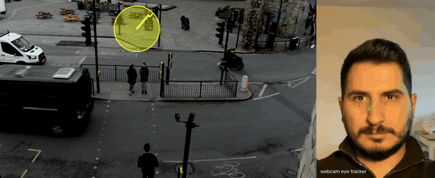

<sub>Left: where I looked in the last second. The yellow disc is the model's uncertainty. Right: the only input, a laptop webcam.</sub>

GazeMap turns a laptop webcam into a simple eye tracker. A neural network trained on the MPIIGaze dataset estimates where each eye is looking. After a one-minute calibration, it maps your gaze to the screen and shows where you looked on any image or video. Everything runs on your own computer.

## About the project
Eye trackers show where people look and how their attention changes. That is used in usability testing, reading research, accessibility tools and driver monitoring. Most of them rely on infrared cameras and special hardware. A normal webcam is everywhere, but it is harder to use due to low resolution, changing light, and every person's eyes look different.

This project asks how well a small model and a webcam can perform, and measures it honestly. It has three parts:

1. **A gaze model:** a CNN trained from scratch in PyTorch and tested only on people it never saw during training.
2. **An evaluation** of what each design choice bought, how calibration holds up, and where the model fails (head turned away, partly covered eyes, gaze outside the training range).
3. **A working demo** that anyone can download, calibrate to themselves and use to record gaze heatmaps on images and video.

## How it works

| 1. Webcam | 2. Calibrate | 3. Check | 4. Map |
|---|---|---|---|
| 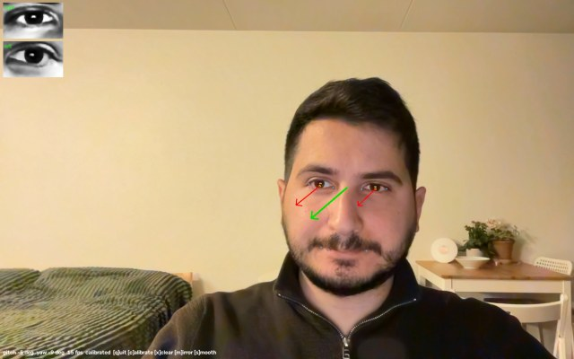 | 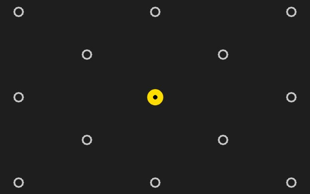 | 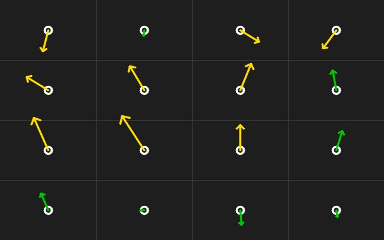 | 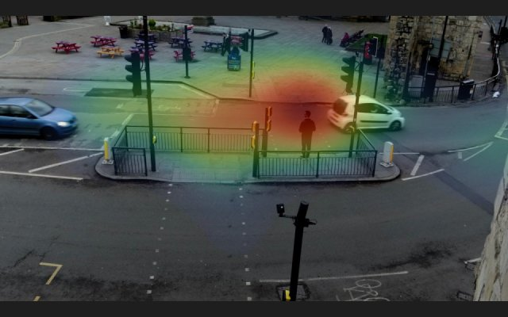 |
| Finds your face and estimates where each eye looks with CNN. | Look at 13 dots to get personalized calibration. | Check accuracy by looking at 16 dots. Each arrow shows the error. | Watch an image or video, get a heatmap. |

MediaPipe finds the eye and mouth corners, a 3D face model gives the head pose, and each eye is cropped and straightened the same way as the training images. The trained CNN predicts a gaze direction per eye, and calibration maps it onto the screen.

## Examples

| Human perception | Complex scenes |
|---|---|
| 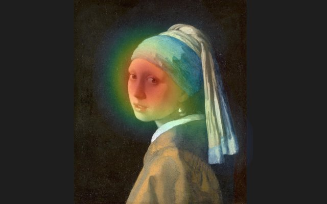 | 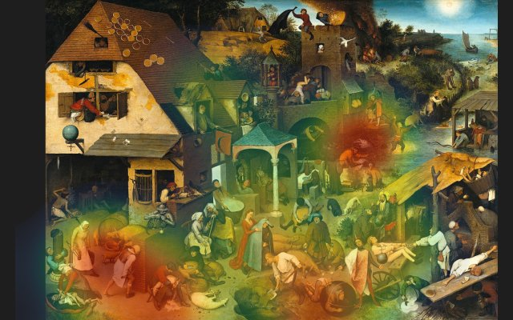 |
| Faces pull attention first. | How attention spreads over a busy image. |
| **Reading** | **Visual search** |
| 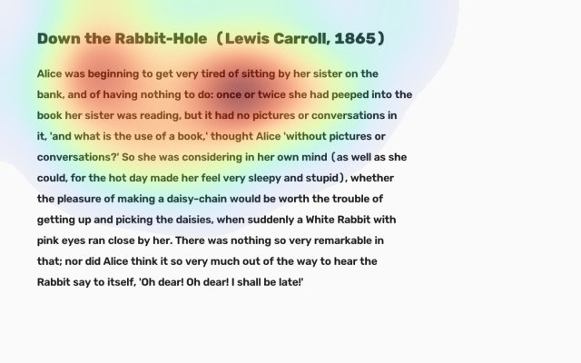 | 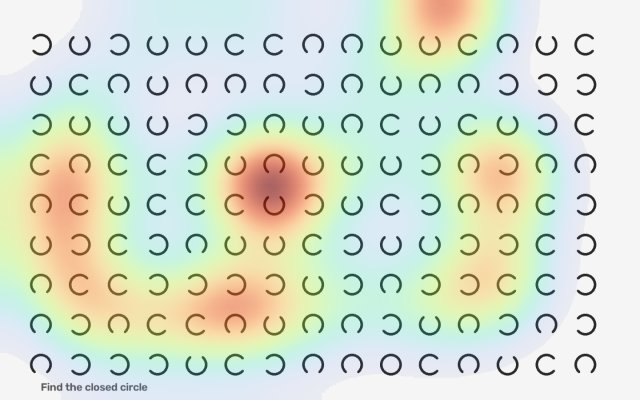 |
| Which lines get read. | How someone scans a layout to find a target. |


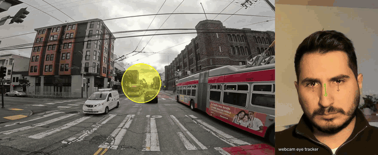

**Driving footage:** where the eyes were when something happened on the road. A research demo, not a driver monitoring system.

## Results

### Setup

| | |
|---|---|
| Dataset | MPIIGaze, normalized eye images: 15 people, 213,658 frames, 427,316 eye images (left eyes mirrored) |
| Protocol | Leave-one-person-out (LOPO): 15 folds, each trains a fresh model on 14 people and tests on the held-out one |
| Metric | Mean angular error (MAE) in degrees between predicted and true 3D gaze vectors |
| Averaging | Person-equal: MAE per held-out person, then the mean over 15 people. ± is the standard error over people |
| Model | 2 conv layers (20, 50 filters, 5×5) + FC 500 + head pose → pitch, yaw. Same layout as MnistNet in Zhang et al. |
| Training | Adam, lr 1e-3 (×0.1 after epoch 10), 15 epochs, batch 128, MSE loss, fixed seed. Last epoch reported, no early stopping on test data |

### Accuracy

| Condition | MAE | People improved |
|---|---|---|
| Unseen person, single eye | 6.03° ± 0.23 | |
| Unseen person, both eyes fused in camera space | 4.97° ± 0.21 | 15/15 |
| + 9-frame offset calibration from one day, tested on all other days | **3.98° ± 0.23** | 13/15 |
| + 13-frame affine calibration (as in the demo), other days | 4.01° ± 0.25 | |
| Webcam demo, 16-point test after calibration (1 user, MacBook Pro 16") | 1.55°, 1.9 cm on screen | |

The demo number is the same-session accuracy for one user; the LOPO numbers are what to expect for a new person in new conditions. Precision (frame-to-frame jitter) in the demo is 0.54°.

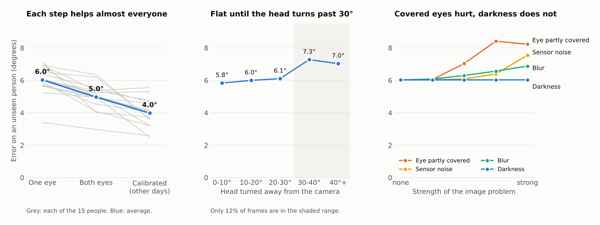

### Failure analysis

| Factor | Condition | MAE | Change |
|---|---|---|---|
| Head rotation away from camera | 0-10° / 10-20° / 20-30° | 5.84° / 6.00° / 6.11° | |
| | 30-40° | 7.28° | +1.4° vs frontal |
| Calibration under head movement | head within 10° of calibration pose | gain 0.86-0.91° | |
| | head turned >20° | gain 0.50° | gain drops ~45% |
| Eye partly covered | top 30% of eye image black | 8.42° | +2.39° |
| Sensor noise | Gaussian, σ = 0.2 | 7.56° | +1.53° |
| Blur | Gaussian, σ = 2 px | 6.88° | +0.85° |
| Low light | pixel values ×0.2, then histogram equalization | 6.03° | +0.00° |

Image conditions are synthetic, applied to each held-out person with no retraining. Head-pose bins are checked within each person: turned samples (≥25°) were worse than frontal (<10°) for 12 of 15 people, so the effect is not just harder people sitting more turned.

### Comparison with published results

Zhang et al. (TPAMI 2019) report LOPO MAE of 6.3° for MnistNet and 5.5° for GazeNet (VGG-16, ImageNet-pretrained). GazeMap's 6.03° uses the MnistNet layout but trains on all frames (~400k eye images per fold) instead of the paper's 3,000 per person (42k per fold), so it is not a like-for-like comparison.

More detail and the checks behind each claim: [docs/EVALUATION.md](docs/EVALUATION.md).

## Quick start

```bash
git clone https://github.com/fammad/GazeMap.git
cd GazeMap
python3 -m venv .venv && source .venv/bin/activate
pip install -r requirements.txt

python gaze_demo.py --calibrate                      # calibrate, then live gaze arrows
python gaze_demo.py --test                           # check accuracy
python gaze_demo.py --heatmap --stimulus image.png   # heatmap on an image or a folder of images
python gaze_demo.py --video clip.mp4                 # gaze trail and heatmap on a video
```

The trained models (about 100 MB) download on the first run. After that no internet is needed. Results are saved in `heatmaps/`.

Tips: sit about 70 cm from the screen with light on your face, and calibrate again if you move. `python get_stimuli.py` downloads the example paintings.

## Train and evaluate it yourself

1. Download [MPIIGaze](https://www.mpi-inf.mpg.de/departments/computer-vision-and-machine-learning/research/gaze-based-human-computer-interaction/appearance-based-gaze-estimation-in-the-wild) into `dataset/`.
2. `python train_lopo.py --all` trains the 15 models and the ablation steps (about 4 hours on an Apple M1).
3. `python evaluate.py`, `python analyze_pose.py` and `python robustness.py` produce the numbers and plots in `results/`.

## Limitations

- It only knows gaze directions that appear in the training data, roughly the area of a laptop screen. Looking far above the camera is not recognised.
- Calibration holds for the position you sat in. Moving your chair or desk needs a new one.
- The on-screen accuracy is from one user on one laptop.
- A webcam is not an infrared eye tracker. Expect centimetres, not millimetres.

## Project files

| File | Purpose |
|---|---|
| `gaze_demo.py` | the demo: calibration, accuracy test, heatmaps, video |
| `gaze_model.py` | the network and data loading |
| `train_lopo.py` | training, one model per held-out person |
| `evaluate.py`, `analyze_pose.py`, `robustness.py` | the evaluation in [docs/EVALUATION.md](docs/EVALUATION.md) |
| `get_stimuli.py` | downloads the example paintings |

## Credits

MPIIGaze dataset: Zhang, Sugano, Fritz and Bulling ([paper](https://arxiv.org/abs/1711.09017)). Face landmarks: Google MediaPipe. Paintings: public domain, via Wikimedia Commons.

## License

- **Code:** [Apache License 2.0](LICENSE). If you use or redistribute it, keep the [NOTICE](NOTICE) file, which credits the author.
- **Trained models:** CC BY-NC-SA 4.0, the same terms as the MPIIGaze dataset they were trained on (non-commercial use only).

## Citation

If GazeMap helps your work, please cite it:

```bibtex
@software{mammadov_gazemap_2026,
  author = {Mammadov, Fuad},
  title  = {GazeMap: Webcam Eye Tracking and Attention Heatmaps},
  year   = {2026},
  url    = {https://github.com/fammad/GazeMap}
}
```

GitHub's "Cite this repository" button gives the same in other formats.
